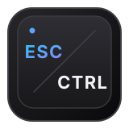

<p align="center">
  
</p>

<h1 align="center">controlesque</h1>

<p align="center">
  <strong>Caps Lock → Escape on tap, Left Control on hold.</strong><br/>
  Zero-dependency macOS HID daemon. No tray icon, no updater, no GUI, ~2 MB RAM.
</p>

<p align="center">
  
  
  
</p>

---

## Why

Karabiner-Elements is great, but if you only need `Caps Lock` → `Esc`/`Ctrl`, running a tray app, updater, and ~100 MB of background services is overkill.

`controlesque` uses the **exact same OS/kernel-level method** as Karabiner-Elements (not `CGEventTap` hacks, so it works everywhere including Secure Input / password prompts):

- **Input:** Exclusively seizes physical keyboards via IOKit (`IOServiceAddMatchingNotification` → `IOHIDDeviceCreate` → `kIOHIDOptionsTypeSeizeDevice`).
- **Output:** Talks directly to the standalone [Karabiner-DriverKit-VirtualHIDDevice](https://github.com/pqrs-org/Karabiner-DriverKit-VirtualHIDDevice) daemon over its Unix socket (auto-detects Protocol 5 / v6.x and Protocol 7 / v8.x).
- **Zero latency chords:** `Left Control` is asserted immediately on Caps Lock down (`Caps+C`, `Caps+[`, `Caps+Click` work instantly); releasing alone within `500ms` emits `Escape`.

---

## Install & Auto-Start

### 1. Install the standalone DriverKit driver *(once)*

Download and install the latest `.pkg` from [Karabiner-DriverKit-VirtualHIDDevice Releases](https://github.com/pqrs-org/Karabiner-DriverKit-VirtualHIDDevice/releases), then activate it:

```bash
sudo /Applications/.Karabiner-VirtualHIDDevice-Manager.app/Contents/MacOS/Karabiner-VirtualHIDDevice-Manager activate
```

Allow `pqrs.org` in **System Settings → Privacy & Security**.

### 2. Build, install & enable boot auto-start

```bash
sudo ./scripts/install.sh
```

This compiles the ~350 KB release binary, installs `/usr/local/bin/controlesque`, and registers `launchd` services for both `Karabiner-VirtualHIDDevice-Daemon` and `controlesque`.

> **Migrating from Karabiner-Elements?** Run `sudo ./scripts/migrate-from-karabiner.sh` first to remove Karabiner-Elements while keeping the DriverKit driver, then run `sudo ./scripts/install.sh`.

### 3. Grant Input Monitoring *(first time only)*

`install.sh` automatically opens **Input Monitoring** if permission is needed, or open it directly:

```bash
open "x-apple.systempreferences:com.apple.preference.security?Privacy_ListenEvent"
```

1. Click **`+`**
2. Press **`Cmd+Shift+G`** and enter `/usr/local/bin/controlesque`
3. Add it and ensure its toggle is **ON**

`controlesque` detects the permission and seizes your keyboard automatically within 2 seconds (no restart needed).

---

## CLI

```bash
sudo controlesque [--timeout-ms 500] [--protocol 5|7] [--verbose]
```

Logs (when running via `launchd`): `/var/log/controlesque.log`

---

## Uninstall

```bash
sudo ./scripts/uninstall.sh                # remove controlesque & LaunchDaemons
sudo ./scripts/uninstall.sh --with-driver  # also remove DriverKit VirtualHIDDevice
```

## License

[MIT](LICENSE)
